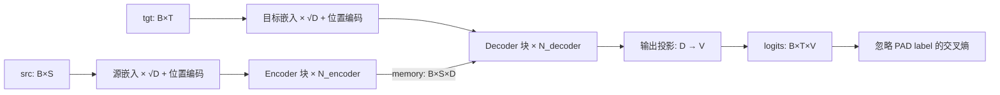

# 从公式到两套代码：Transformer 学习指南

这份指南按一次训练所经过的路径组织：准备 token → 嵌入与位置编码 → encoder → decoder → loss → backward → SGD；最后再把 teacher forcing 换成逐 token 生成。Python 和 C++ 遵循 [DESIGN.md](DESIGN.md) 中的同一数学与文件契约。

建议先运行根目录的 `make check` 与 `make demo`，然后选一组很小的配置阅读代码。默认 `D=8, H=2, F=16` 足以跟踪全部张量，也能让 C++ 的循环和手写梯度保持可读。

## 1. 先把形状和训练数据对齐

### 符号

| 符号 | 含义 | 典型张量 |
|---|---|---|
| `B` | batch 中的样本数 | `src[B,S]` |
| `S` | 本批次的源序列长度，包含 PAD 位置 | encoder 输出 `[B,S,D]` |
| `T` | 本批次的目标输入长度，包含 PAD 位置 | decoder 输出 `[B,T,D]` |
| `D` | 模型宽度 `d_model` | 每个 token 的表示长度 |
| `H` | 注意力头数，要求 `D % H == 0` | 每个 head 宽度 `d_h=D/H` |
| `F` | FFN 中间层宽度 `d_ff` | ReLU 输出 `[B,T,F]` |
| `V` | 词表大小；源与目标使用相同的 ID 范围 | logits `[B,T,V]` |

token ID 是整数，范围为 `[0,V)`。`PAD=0`、`BOS=1`、`EOS=2` 是演示使用的约定；模型配置记录 `pad_id`，生成接口另接收 BOS/EOS。源和目标嵌入分别学习 `[V,D]` 参数，即使词表范围相同，也不会共享权重。

### teacher forcing：输入右移，label 不右移

设一条源序列是 `[4,7,5]`，希望输出同一条序列并结束。训练时构造：

```text
src     = [4,   7, 5]
tgt     = [BOS, 4, 7, 5]
labels  = [4,   7, 5, EOS]
```

`logits[:,t,:]` 对应 `labels[:,t]`。在位置 `t`，decoder 已知 `tgt` 中截至 `t` 的 token，预测它后面的一个 token。BOS 给第一步提供输入，EOS 也是一个需要预测的普通类别。变长序列按批次补 PAD；`tgt` 与 `labels` 必须具有相同的 `[B,T]` 形状。

teacher forcing 在训练时使用真实的历史 token，所有位置可同时计算。生成时使用模型自己已经输出的 token，因此每一步都要重新决定下一个 token。训练和生成的历史不同，是理解「loss 已下降但生成仍有错误」的起点。

### 训练中真正发生的事

```text
logits = model(src, tgt)             # [B,T,V]
loss   = masked_cross_entropy(...)  # 一个标量
zero_grad()
loss.backward()
parameter -= learning_rate * gradient
```

一次 `inspect` 正好覆盖这个流程，但将前向值、梯度和更新后的权重写入文件，方便另一套实现逐项核对。`train` 重复这个流程，演示始终使用 case 里保存的固定小批次。

## 2. 沿着一条前向路径读模型

下面每个「块」都可以堆叠多层。encoder 的最终输出作为 memory，被所有 decoder 层的 cross-attention 使用。



### 2.1 嵌入与位置编码

嵌入是按 token ID 查表，再乘以 `sqrt(D)`。源序列初始表示为：

$$
X_{b,s,:}=\sqrt{D}\,E_{\mathrm{src}}[\mathrm{src}_{b,s}]+PE_{s,:}.
$$

位置从 `0` 开始。对于存在的维度 `2i` 与 `2i+1`：

$$
PE_{p,2i}=\sin\!\left(p/10000^{2i/D}\right),\qquad
PE_{p,2i+1}=\cos\!\left(p/10000^{2i/D}\right).
$$

位置编码由公式生成，保持 `[max_len,D]`，没有可训练参数；`TLAB1` 也不保存它。`max_len` 限制可接受的输入与生成前缀长度。若 `D` 为奇数，最后一个维度只取其对应的正弦项。这些公式与下面的注意力、FFN 结构可对照原论文第 3 节：[Attention Is All You Need](https://arxiv.org/abs/1706.03762)。

### 2.2 线性投影与多头布局

本仓库的线性层权重形状为 `[D_out,D_in]`，计算约定是：

$$
Y=XW^\top+b.
$$

attention 的 Q/K/V 投影先得到 `[B,L,D]`。数学上将最后一维拆成 `[H,d_h]` 并换轴，得到 `[B,H,L,d_h]`。Python 显式进行 reshape 和 transpose；C++ 保留 `[B,L,D]` 的连续存储，用 `h*d_h+d` 访问 head 内分量。两种写法必须让 head 与位置一一对应，不能仅凭元素总数相同就随意 reshape。

令 query 长度为 `L_q`，key/value 长度为 `L_k`，每个 head 计算：

$$
Z=QK^\top/\sqrt{d_h},\quad
P=\operatorname{softmax}(Z+M),\quad
O=PV.
$$

`Z` 与 `P` 的形状为 `[B,H,L_q,L_k]`。`M` 在允许的位置为 `0`，屏蔽的位置为 `-∞`。softmax 沿最后一维执行：每个 query 为所有允许的 key 分配总和为 `1` 的权重。然后将各 head 的输出还原为 `[B,L_q,D]`，再经独立的输出投影。Q/K/V/O 四个投影均有 bias。

attention 公式中的 `V` 表示 value 矩阵，形状为 `[B,H,L_k,d_h]`；它与形状表中的词表大小 `V` 是两个含义。

三处 attention 复用同一个数学算子，却接收不同的输入：

| 位置 | Q 来源 | K、V 来源 | 分数形状 |
|---|---|---|---|
| encoder self-attention | 当前 encoder 表示 | 同一表示 | `[B,H,S,S]` |
| decoder self-attention | 当前 decoder 表示 | 同一表示 | `[B,H,T,T]` |
| decoder cross-attention | decoder self-attention 后的表示 | encoder 最终 memory | `[B,H,T,S]` |

cross-attention 的 query 轴和 key 轴属于不同序列，`S` 与 `T` 可以不同；这也是验证器必须覆盖不同源/目标长度的原因。

### 2.3 Post-LN、残差与 FFN

每个子层使用 `LayerNorm(x + Sublayer(x))`。这是原论文风格的 Post-LN，归一化发生在残差相加之后。它决定了前向顺序，也决定了梯度经过的路径。

encoder 一层：

$$
X_1=\operatorname{LN}_1(X+\operatorname{SelfAttn}(X)),\qquad
X_2=\operatorname{LN}_2(X_1+\operatorname{FFN}(X_1)).
$$

decoder 一层：

$$
Y_1=\operatorname{LN}_1(Y+\operatorname{CausalSelfAttn}(Y)),
$$
$$
Y_2=\operatorname{LN}_2(Y_1+\operatorname{CrossAttn}(Y_1,\mathrm{memory})),\qquad
Y_3=\operatorname{LN}_3(Y_2+\operatorname{FFN}(Y_2)).
$$

FFN 独立作用于每个位置，位置之间共享同一组参数：

$$
\operatorname{FFN}(x)=\operatorname{ReLU}(xW_1^\top+b_1)W_2^\top+b_2,
$$

其中 `W1[F,D]`，`W2[D,F]`。它在特征维度上做 `D → F → D` 变换，序列长度保持不变。

LayerNorm 对每个 token 的最后 `D` 个分量计算：

$$
\mu=\frac1D\sum_i x_i,\qquad
v=\frac1D\sum_i(x_i-\mu)^2,\qquad
\hat x_i=\frac{x_i-\mu}{\sqrt{v+\epsilon}},\qquad
y_i=\gamma_i\hat x_i+\beta_i.
$$

这里使用总体方差，分母为 `D`，`eps` 位于平方根内部。`gamma`、`beta` 都是 `[D]` 的可学习参数。PyTorch 的 `LayerNorm` 使用相同的方差约定，可查看 [官方说明](https://docs.pytorch.org/docs/stable/generated/torch.nn.LayerNorm.html)。

### 2.4 logits、稳定交叉熵与 SGD

最终输出投影使用 `generator.weight[V,D]` 与 `generator.bias[V]`，得到 logits `[B,T,V]`。模型返回 logits，loss 内部再进行稳定的 log-sum-exp 计算。

令有效 label 数为 `N`，对非 PAD 的位置集合 `I`：

$$
\mathcal L=\frac1N\sum_{(b,t)\in I}
\left[\log\sum_{v=0}^{V-1}e^{z_{b,t,v}}-z_{b,t,\mathrm{label}_{b,t}}\right].
$$

实现时先减去该行最大值，避免直接 `exp(logit)` 溢出。均值除以非 PAD token 的数量，而非 `B*T`；所有 labels 都是 PAD 时拒绝计算，避免无意义的除零。

一次 SGD 更新是 `theta ← theta - learning_rate * grad`。这里没有 momentum、weight decay、梯度裁剪或学习率调度，更新文件可直接用这条公式检查。

## 3. mask：先明确轴，再明确含义

仓库内部的布尔 mask 规定 **`True` 表示允许 attention**。使用其他库的 mask API 时，应先核对它对布尔值的定义。

### 因果性与右移必须一起成立

decoder self-attention 在 query 位置 `i` 只允许 key 位置 `j <= i`。一个长度为 4 的允许矩阵为：

```text
        key j
        0 1 2 3
query 0 1 0 0 0
      1 1 1 0 0
      2 1 1 1 0
      3 1 1 1 1
```

当前位置可读取 `tgt[i]`，因为该 token 是要预测的 `labels[i]` 的前一个 token。若忘记右移，模型就可能直接看到待预测答案；若忘记因果 mask，模型又可能读取后面的真实 token。只看训练 loss 下降，无法排除这些泄漏。

### PAD mask 屏蔽的是 key

允许关系可以写成：

```text
encoder:    allowed[b,i,j] = src[b,j] != PAD
decoder:    allowed[b,i,j] = (j <= i) and (tgt[b,j] != PAD)
cross:      allowed[b,i,j] = src[b,j] != PAD
```

这里 `j` 是 key 位置。PAD query 的输出可以存在，模型也不强制把它归零；监督由 label mask 决定。有效 query 应无法通过 attention 读取 PAD key，cross-attention 也必须屏蔽源 PAD。

一行若没有任何允许的 key，softmax 没有定义，两个实现都应抛出错误。数据契约要求每条源序列至少有一个非 PAD token，每条目标序列第一个 token 非 PAD，从而为所有因果 query 保留可用的 key。

嵌入层没有使用 `padding_idx` 自动冻结某行。PAD 相关的梯度取决于其是否通过实际计算路径影响非 PAD loss；应沿图和 mask 分析，不能仅凭 token 名字判断。

## 4. C++ 的 backward：把链式法则落实到每个算子

Python 负责展示算子之间的数学关系；C++ 把每个算子的局部梯度显式写出来。先读一个简单线性层，再读 softmax 与 LayerNorm，最后读完整 attention。

以下用上游梯度 `G = ∂L/∂Y` 表示该算子输出收到的梯度。矩阵公式可对每个 batch/head 分别应用；广播发生时，反向传播需要沿被广播的轴求和。

### 4.1 线性层、查表、ReLU 和布局

将所有位置展平为 `X[M,D_in]`，`Y=XW^T+b`：

$$
\frac{\partial L}{\partial X}=GW,\qquad
\frac{\partial L}{\partial W}=G^\top X,\qquad
\frac{\partial L}{\partial b}=\sum_{m=1}^{M}G_{m,:}.
$$

embedding 的 backward 是按 token ID 把上游梯度加回对应行。同一个 token 出现多次时必须累加；乘以 `sqrt(D)` 的梯度也要乘相同的常数。

ReLU 在正输入处传递梯度，在负输入与本实现约定的零点处传递 `0`。有限差分应避开恰好为零的输入，因为该点不可微。显式 reshape 的 backward 恢复原形状，transpose 的 backward 应用逆置换；C++ 的 attention 则直接把梯度累加到原布局对应的下标。布局也属于需要核对的计算路径。

### 4.2 softmax 与注意力

一行 softmax `p_i=exp(z_i)/sum_j exp(z_j)` 的雅可比为 `∂p_i/∂z_j=p_i(δ_ij-p_j)`。无需构造完整矩阵，对上游梯度 `g` 直接计算：

$$
\frac{\partial L}{\partial z_i}=p_i\left(g_i-\sum_j p_jg_j\right).
$$

被屏蔽位置的概率与分数梯度均为 `0`。于是 attention 的反传可以逐步展开：

$$
O=PV:\quad dV=P^\top dO,\qquad dP=dO\,V^\top,
$$
$$
dZ=P\odot\left(dP-\operatorname{sum}_{\mathrm{key}}(P\odot dP)\right),
$$
$$
Z=QK^\top/\sqrt{d_h}:\quad
dQ=dZ\,K/\sqrt{d_h},\qquad
dK=dZ^\top Q/\sqrt{d_h}.
$$

这里 `dZ` 已包含 mask 的零梯度约束。再通过 Q/K/V/O 线性层，便可得到投影参数以及输入表示的梯度。self-attention 的 Q/K/V 来自同一个节点，三条路径对该输入的贡献必须相加。

### 4.3 LayerNorm

对于一行，记 `r=1/sqrt(v+eps)`，`u_i=G_i*gamma_i`。输入梯度可以写成：

$$
dx_i=\frac rD\left(Du_i-\sum_j u_j-\hat x_i\sum_j u_j\hat x_j\right).
$$

共享参数的梯度需要跨所有 batch 和位置累加：

$$
d\gamma_i=\sum_{\mathrm{rows}}G_i\hat x_i,\qquad
d\beta_i=\sum_{\mathrm{rows}}G_i.
$$

这一形式同时包含均值和方差对输入的依赖。若只把 LayerNorm 当成「除以标准差」，漏掉这两条路径，前向可能完全正确而梯度仍然错误。

### 4.4 交叉熵

令 `p=softmax(logits)`。有效 label 位置的梯度为：

$$
\frac{\partial\mathcal L}{\partial z_{b,t,v}}
=\frac1N\left(p_{b,t,v}-\mathbf1[v=\mathrm{label}_{b,t}]\right).
$$

PAD label 位置的整行梯度是 `0`，而有效位置上 PAD 仍是词表中的一个候选类别。忽略 PAD label，与从 softmax 中删除 PAD 类别，是两种不同的计算。

### 4.5 计算图是一张 DAG

一个节点可以被多个子节点使用。最简单的例子是 `y=x+x`，其梯度是 `2`；残差 `y=x+f(x)` 则贡献 `G` 加上 `f` 路径返回的梯度。encoder memory 还会同时被多层 decoder 的 cross-attention 使用。

reverse-mode autograd 的步骤是：

1. 从 loss 找到全部可达节点，按依赖关系建立拓扑顺序。
2. 将标量 loss 的种子梯度设为 `1`，其他梯度置零。
3. 按逆拓扑顺序调用局部 backward，向父节点使用 `+=` 累加。
4. 待所有使用方贡献完成后，才传播一个节点自己的梯度。

遍历时可对同一个节点只登记一次，但局部算子中同一个父节点出现两次，仍必须贡献两次梯度。把反向传播写成递归树、用赋值覆盖 `+=`，或者过早处理共享节点，都可能漏梯度。新训练步还需要清空旧梯度，避免将不同步的梯度混在一起。

## 5. 从训练切换到 greedy decode

生成先给每条源序列一个 `[BOS]` 前缀，然后重复：

1. 用当前前缀执行 decoder，取最后一个位置的 logits。
2. 选择分数最大的 token，追加到前缀。
3. 遇到 EOS 标记该样本结束；其他样本继续时，该样本后续补 PAD。
4. 所有样本结束或达到 `max_new_tokens` 时停止。

返回序列包含 BOS，所以 `max_new_tokens` 限制的是 BOS 后新增的 token 数。EOS 被保留。生成也受 `max_len` 约束，使用时需为前缀留出足够空间。

本实现没有 KV cache，前缀增长时会重新计算相关 attention，便于与训练时的路径对照。greedy 是逐步的局部选择，没有搜索多个候选序列。

## 6. TLAB1：让两套实现做同一个实验

相同随机种子不保证不同语言得到相同初始权重。这里由 Python 导出一次权重与 batch，两边再读取同一文件。文件是 UTF-8、空白分隔的文本，浮点数使用 17 个有效数字；张量按连续 row-major 顺序保存。

语法如下：

```text
TLAB1
record_count
name rank dim_0 ... dim_(rank-1)
value_0 value_1 ... value_(numel-1)
...后续记录...
```

每条记录先给名字和形状，再给相应数量的值。换行用于阅读，解析按空白分隔。rank 范围为 `1..4`，维度都为正，标量用 `[1]` 表示。所有值必须有限；重复名字、截断、额外尾部 token、超限尺寸都应被拒绝。

一个可训练 case 包含：

| 记录 | 形状 | 含义 |
|---|---|---|
| `config` | `[9]` | `V,D,H,F,N_encoder,N_decoder,max_len,pad_id,eps` |
| `learning_rate` | `[1]` | 正且有限的 SGD 学习率 |
| `src` | `[B,S]` | 源 token |
| `tgt`、`labels` | `[B,T]` | 右移后的目标输入与监督 |
| 全部命名参数 | 按参数定义 | 如 `generator.weight[V,D]` |

token 和整型配置也以 double 写入，但读取后必须验证它们是精确整数，并满足范围约束。线性层按 `[out,in]` 存储，文件读取过程中不再转置。

两个实现使用相同参数名字，例如：

```text
src_embedding.weight
encoder.0.self_attn.q_proj.weight
encoder.0.norm1.weight
decoder.0.cross_attn.v_proj.bias
generator.weight
```

`inspect` 的输出包含 `encoder_output`、`decoder_output`、`logits`、`loss[1]`，以及所有 `grad.<参数名>` 与 `updated.<参数名>`。`train` 保存的 checkpoint 仍是完整 case，保留配置、学习率和 batch，只替换训练后的权重，因此可跨语言继续训练或生成。

Python 的 `pyproject.toml` 声明项目与依赖，`uv.lock` 固定解析版本；`uv run --locked` 使用这份环境，锁文件与项目不一致时会报错。环境组织方式可查 [uv 项目文件说明](https://docs.astral.sh/uv/concepts/projects/layout/)。

## 7. 怎样判断实现可信

单看 loss 下降，证据很有限。这里使用四类互相补充的检查：

| 检查 | 能发现什么 | 仍需其他检查补足什么 |
|---|---|---|
| 独立的数学与行为测试 | attention 公式、位置编码、mask 隔离、EOS 和输入边界 | 完整模型中算子组合是否一致 |
| PyTorch 官方 encoder/decoder 层参考 | 在相同参数与 mask 下，检查 Post-LN 层的前向组合 | 手写 backward 是否正确 |
| Python / C++ 对照 | encoder/decoder 输出、logits、loss、全部参数梯度、一次 SGD 更新差异 | 两套实现是否犯了同样的概念错误 |
| 中央有限差分 | backward 是否匹配本实现前向的局部导数 | 前向结构是否符合目标架构 |

官方层仅出现在验证器中，核心实现仍自行组装 attention、FFN、残差和 LayerNorm。验证器还运行多步 SGD，双向读取 checkpoint，检查 greedy 结果与 EOS 提前停止，并要求两套实现拒绝同一组损坏文件和非法 case。

float64 的跨语言元素比较采用：

$$
|x_{\mathrm{cpp}}-x_{\mathrm{python}}|
\le 10^{-9}+10^{-8}|x_{\mathrm{python}}|.
$$

token 序列使用精确比较。浮点计算顺序会影响末位，所以前向一致并不要求逐位相等；若误差超出容差，应定位到具体记录与元素，检查形状、mask、转置、归一化和累加过程。多层、padding 和 `S != T` 都应覆盖，不能只用一层、无 PAD、等长输入验收。

中央差分对某个参数分量使用：

$$
g_{\mathrm{numeric}}=\frac{\mathcal L(\theta+h)-\mathcal L(\theta-h)}{2h}.
$$

`h` 太大会有截断误差，太小会有浮点消减误差；在 double 上可先尝试 `1e-6`，再看不同步长下是否稳定。有限差分有自己的误差，应根据所测算子另设合理容差。遇到 ReLU 的不可微点，应更换测试输入，而不是要求一个不存在的唯一导数。

## 8. 代码阅读路线

建议按下表逐步阅读，每次只追踪一种张量和它对应的梯度。

| 顺序 | Python | C++ | 阅读目标 |
|---|---|---|---|
| 1 | [`model.py`](python/src/transformer_lab/model.py) 的配置与输入校验 | [`model.hpp`](cpp/include/tlab/model.hpp)、[`model.cpp`](cpp/src/model.cpp) | 明确形状、token 与数值约束 |
| 2 | `model.py` 的嵌入、位置编码、attention | [`tensor.hpp`](cpp/include/tlab/tensor.hpp)、[`tensor.cpp`](cpp/src/tensor.cpp) 的对应算子 | 对照布局与 Q/K/V 来源 |
| 3 | `model.py` 的 encoder、decoder、loss | `model.cpp` 的模型组装与 loss | 沿 Post-LN 前向路径读完整网络 |
| 4 | PyTorch 对应运算的梯度使用 | `tensor.cpp` 的局部 backward 和拓扑遍历 | 推导并检查梯度累加 |
| 5 | [`format.py`](python/src/transformer_lab/format.py) | [`format.hpp`](cpp/include/tlab/format.hpp)、[`format.cpp`](cpp/src/format.cpp) | 核对命名参数与 TLAB 输入 |
| 6 | [`cli.py`](python/src/transformer_lab/cli.py) | [`main.cpp`](cpp/src/main.cpp) | 对照 inspect、train 与 generate |
| 7 | [`python/tests`](python/tests/) | [`cpp/tests`](cpp/tests/) 与 [`verify.py`](verify.py) | 从测试观察正确行为和错误边界 |

阅读代码注释时，尤其留意「最后一个轴是什么」「哪个输入是同一个节点」「哪些维度被广播」这三个问题。多数表面相似的实现差异，都可以沿这些问题定位。

## 9. 可以立即做的实验

### 实验 A：改变未来 token

固定 `src` 与目标前缀，将 `tgt` 的一个后续非 PAD token 改成另一个非 PAD token，比较更早位置的 logits。

**应观察到：** 更早位置的输出保持不变，允许的浮点误差内一致。更晚位置可以变化。若更早位置变化，检查 causal mask 的 query/key 轴及布尔含义。测试时保持 PAD 模式不变，以便只测未来信息隔离。

### 实验 B：改变 PAD 的嵌入

构造有源 PAD 的 case，仅改变 `src_embedding.weight[pad_id]`，比较有效 decoder 输出。

**应观察到：** 有效输出保持不变，因为源 PAD key 在 encoder 和 cross-attention 都被屏蔽。PAD query 自身的 encoder 输出可以变化；这不代表屏蔽失败。

### 实验 C：验证重复使用的梯度

在 C++ 张量层构造标量 `y=x+x` 并调用 backward，再构造一个小的线性残差例子。对同一 token 出现两次的 embedding 也做测试。

**应观察到：** `dy/dx=2`；残差输入梯度等于直接路径与线性路径之和；重复 token 的嵌入梯度等于两次查表贡献之和。此实验能快速暴露 `=` 覆盖梯度、丢失重复边等问题。

### 实验 D：多层与不同长度

使用两个 encoder 层、两个 decoder 层，并构造 `S != T`、部分样本有 PAD 的 batch。先分别 `inspect`，再运行跨语言验证。

**应观察到：** memory 的 key 长度为 `S`，decoder query 长度为 `T`；两边所有命名参数都有梯度记录。若一层 case 正常而多层 case 失败，重点检查共享 memory 的累加以及每层参数是否独立。

### 实验 E：观察拟合与生成的差别

对同一 case 训练若干步，在不同步数保存 checkpoint；同时记录训练 loss 和训练源序列上的 greedy token。先用 `make demo` 中的小配置，再改变学习率或增加步数。

**应观察到：** 合理配置下，固定 batch 可以被逐渐拟合；loss 连续变化，而 argmax token 只在类别顺序翻转时变化。生成错误可能在多个位置连锁出现，因为后续输入使用模型自己的预测。

接着单独构造未参与训练的序列，并与训练序列分开统计。**这一步才开始检验泛化**：固定批次拟合成功既不要求未见样本正确，也不证明模型学到了通用复制算法。评估更长序列还需要检查 `max_len` 和长度分布。

### 实验 F：亲手制造一个错误

在临时分支中移除 `1/sqrt(d_h)`，或把 cross-attention 的源 PAD mask 去掉，再运行相关测试和 verifier。

**应观察到：** 若只改一套实现，跨语言对照会报告差异；若两套都作同样修改，对照仍可能通过，因此独立公式与行为测试仍不可少。实验后恢复原始数学契约。

## 10. 学完核心以后再扩展

可以依次尝试新的 toy 数据集、独立验证集、优化器、dropout、beam search、KV cache，再考虑 CUDA 与高性能算子。每次只增加一个机制，并写明它如何改变前向、backward、文件或生成行为。

保留一份原始 float64 实现作为参考，有助于区分算法改变、数值精度差异与性能改写。生产系统中的速度、吞吐量和大规模训练配方，需要另一套评测目标；本仓库首先回答的是「每个值如何算出，每个梯度从何而来」。
